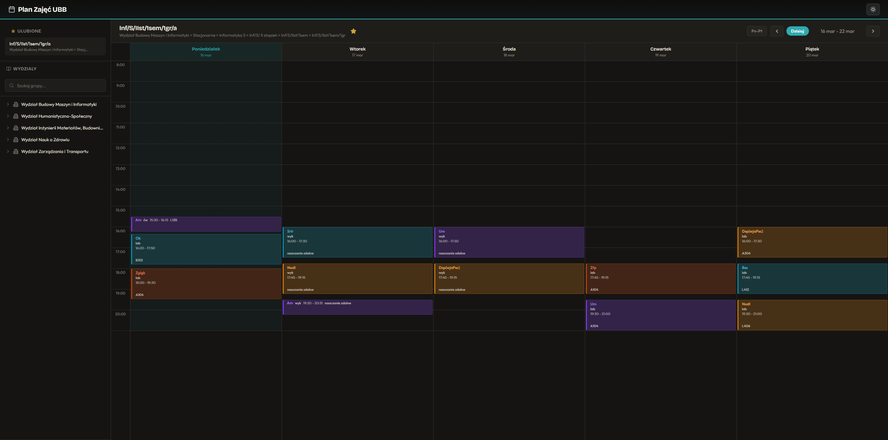

# Plan Zajęć UBB

Alternatywny widok planu zajęć Uniwersytetu Bielsko-Bialskiego, jako zamiennik dla [plany.ubb.edu.pl](https://plany.ubb.edu.pl/).

**Live: [ubbplan.vercel.app](https://ubbplan.vercel.app/)**



## Funkcje

- Wspólna wyszukiwarka grup, prowadzących i sal, z filtrowaniem i obsługą klawiatury
- Przeglądanie wydziałów i kierunków po jednym poziomie
- Lista dnia na telefonie i kalendarz tygodniowy na komputerze; zapamiętywany wybór widoku
- Wybór daty, nawigacja tygodniowa, przerwy i wyróżnienie najbliższych zajęć
- Osobny „Mój plan”, zapisane plany z własnymi nazwami oraz historia przeglądania
- Zwarty panel planów bez duplikatów; historia, wydziały i informacje UBB rozwijane na żądanie
- Siatka tygodnia na komputerze dopasowana do wysokości okna, bez przewijania godzin
- Szczegóły z datą i bezpośrednimi odnośnikami do planów sal, grup i prowadzących
- Powrót do własnego planu z zachowaniem tygodnia, dnia i przewinięcia
- Czas pobrania danych, stany pustego planu i ponawianie nieudanego pobrania
- Tryb ciemny / jasny

## Tech stack

- React 19 + TypeScript
- Vite
- Dane pobierane z API plany.ubb.edu.pl

## Uruchomienie

```bash
npm install
npm run dev
```

## Build

```bash
npm run build
```

## Testy

Wymagany Node.js 22.18 lub nowszy.

```bash
npm test
```
